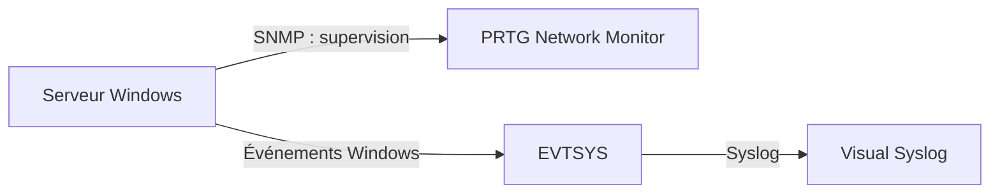

# Supervision réseau et centralisation des journaux avec PRTG

Mise en place d’un environnement de laboratoire pour superviser un serveur Windows avec **PRTG Network Monitor** et centraliser ses événements avec **EVTSYS** et **Visual Syslog**.

## À propos du projet

Ce projet explore deux besoins courants en administration système et réseau :

- superviser la disponibilité et les performances d’un équipement Windows ;
- centraliser ses événements système afin de faciliter leur consultation.

PRTG est utilisé pour la supervision via SNMP. EVTSYS transmet les événements Windows vers Visual Syslog, où ils peuvent être consultés.

## Architecture du laboratoire

## Réalisations

- Préparation d’un environnement Windows virtualisé.
- Installation et prise en main de PRTG Network Monitor.
- Configuration des utilisateurs et des groupes dans PRTG.
- Ajout d’un équipement Windows supervisé via SNMP.
- Configuration de capteurs de disponibilité et de performance.
- Exploration du système de tickets de PRTG.
- Installation de Visual Syslog et configuration d’EVTSYS pour l’envoi des événements Windows.

## Résultats

Le laboratoire permet de :

- visualiser un équipement Windows dans PRTG ;
- consulter des données de disponibilité et de performance ;
- explorer les informations système remontées par les capteurs ;
- consulter dans Visual Syslog les événements transmis depuis Windows.

## Documentation

Le manuel technique présente le déploiement, les configurations et les captures d’écran du projet.

[📘 Consulter le manuel technique](manuel-prtg-syslog.pdf)

## Technologies et compétences

**Technologies :** PRTG Network Monitor, Visual Syslog, EVTSYS, Windows Server, SNMP, Syslog et virtualisation.

**Compétences mobilisées :**

- supervision d’équipements et de services ;
- administration d’un environnement Windows Server ;
- configuration et utilisation de SNMP ;
- collecte et consultation de journaux système ;
- documentation technique.

## Pistes d’amélioration

- Configurer et tester des notifications de supervision.
- Étudier les options de sécurisation des échanges SNMP et Syslog.

